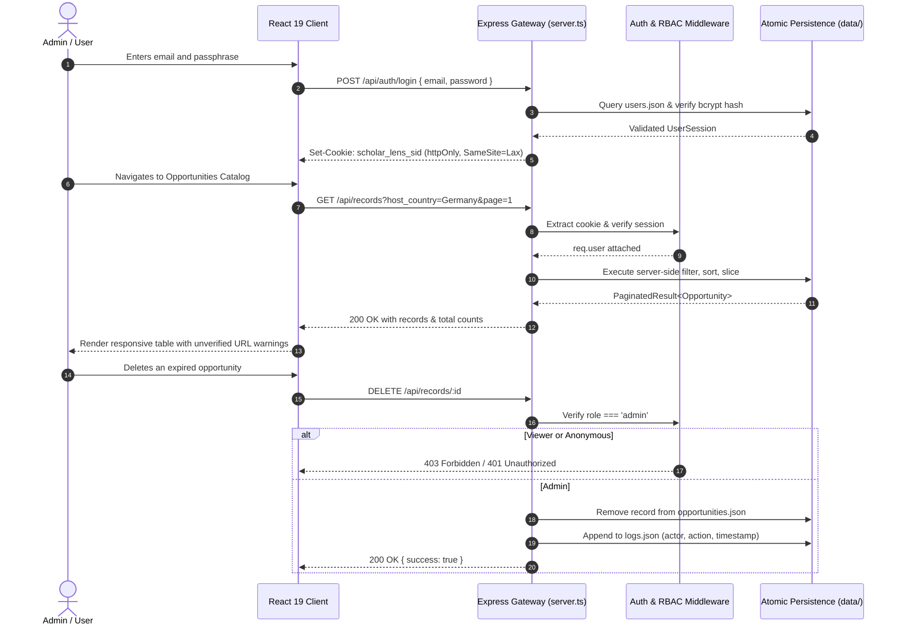

# Scholar Lens: Architecture & Technical Design Specification
## B.Tech Final-Year Capstone Project | Full-Stack Web Application

---

## 1. System Overview & Request Flow

Scholar Lens is architected as a decoupled, full-stack application. In both development and production, requests flow through an Express 4 application gateway before reaching either client-side SPA routes or API endpoints.

---

## 2. Authentication & Session Flow

* **Transport Security:** Sessions are maintained via `httpOnly`, `SameSite=Lax` cookies named `scholar_lens_sid`. 
* **Protection against XSS:** Because the cookie is marked `httpOnly`, client-side JavaScript (including compromised third-party dependencies) cannot access the session token.
* **Protection against CSRF:** `SameSite=Lax` ensures browser will not attach the session cookie on cross-site state-changing POST/PUT/DELETE requests.
* **Password Hashing:** Stored user records in `data/users.json` contain salted bcrypt hashes (`saltRounds = 10`). Plaintext passwords never enter persistence.

---

## 3. Authorization Matrix

| Endpoint | Method | Public | Viewer Role | Admin Role | Enforced Response for Violations |
|---|---|:---:|:---:|:---:|---|
| `/api/auth/login` | POST | Yes | Yes | Yes | `400 Bad Request` or `401 Unauthorized` |
| `/api/auth/logout` | POST | Yes | Yes | Yes | `200 OK` |
| `/api/auth/session` | GET | Yes | Yes | Yes | Returns `{ user: null }` if anonymous |
| `/api/records` | GET | No | **Yes** | **Yes** | `401 Unauthorized` |
| `/api/records/:id` | GET | No | **Yes** | **Yes** | `401 Unauthorized` |
| `/api/records` | POST | No | No | **Yes** | `403 Forbidden` |
| `/api/records/:id` | PUT | No | No | **Yes** | `403 Forbidden` |
| `/api/records/:id` | DELETE | No | No | **Yes** | `403 Forbidden` |
| `/api/records/import` | POST | No | No | **Yes** | `403 Forbidden` |
| `/api/records/export` | GET | No | **Yes** | **Yes** | `401 Unauthorized` |
| `/api/stats` | GET | No | **Yes** | **Yes** | `401 Unauthorized` |
| `/api/activity` | GET | No | **Yes** | **Yes** | `401 Unauthorized` |
| `/api/data-quality` | GET | No | **Yes** | **Yes** | `401 Unauthorized` |
| `/api/admin/reset-seed` | POST | No | No | **Yes** | `403 Forbidden` |

---

## 4. Opportunity Data Model (25 Fields)

Each opportunity record adheres to the following specification:

| Field | Type | Required | Description |
|---|---|:---:|---|
| `id` | `string` | Yes | Unique identifier (e.g., `opp-lt-001`, `opp-wk-001`) |
| `title` | `string` | Yes | Title of the scholarship or fellowship |
| `provider_name` | `string` | Yes | Name of the issuing agency, foundation, or university |
| `provider_type` | `enum` | Yes | `'university'`, `'foundation'`, `'government'`, `'corporate'` |
| `host_country` | `string` | Yes | One of 25 supported destination nations |
| `host_institution` | `string` | Yes | Target educational institution |
| `degree_level` | `enum` | Yes | `'masters'`, `'masters_or_phd'` |
| `funding_type` | `enum` | Yes | `'full'`, `'partial'`, `'stipend_only'`, `'tuition_waiver'`, `'travel_grant'` |
| `funding_summary` | `string` | Yes | Descriptive explanation of financial coverage |
| `funding_amount_note` | `string` | Yes | Specific stipend amounts, monthly grants, or currency breakdown |
| `fields_of_study` | `string[]` | Yes | Array of eligible disciplines (CS, AI/ML, Robotics, VLSI, etc.) |
| `eligibility_summary` | `string` | Yes | Academic qualifications and degree requirements |
| `indian_applicants_eligible` | `boolean` | Yes | Eligibility flag for Indian citizens |
| `min_gpa_note` | `string` | Yes | Minimum CGPA or academic percentage criteria |
| `language_requirements` | `string` | Yes | English language test specifications (IELTS, TOEFL, MOI) |
| `application_deadline` | `string \| null` | No | ISO Date string (`YYYY-MM-DD`) or null for rolling intakes |
| `deadline_note` | `string` | Yes | Explanatory note for timezone, rounds, or rolling schedules |
| `official_url` | `string` | Yes | Official portal URL (flagged if placeholder `example.com`) |
| `tags` | `string[]` | Yes | Searchable keywords and taxonomies |
| `popularity_tier` | `enum` | Yes | `'long_tail'`, `'well_known'` |
| `curated_by` | `string` | Yes | Name of verifying administrator |
| `verified_on` | `string` | Yes | ISO Date of last administrative audit |
| `is_active` | `boolean` | Yes | Visibility flag in candidate catalogs |
| `created_at` | `string` | Yes | ISO Timestamp of creation |
| `updated_at` | `string` | Yes | ISO Timestamp of last modification |

---

## 5. Security & Invariant Defenses

1. **CSV Formula Injection:** Evaluates every exported cell. If an exported string starts with `=`, `+`, `-`, or `@`, it is escaped by prefixing a single quote (`'`), preventing formula execution when opened in Excel or Google Sheets.
2. **Dynamic Temporal Computation:** Application deadline statuses (`open`, `closing`, `expired`, `none`) are calculated at query time against today's date rather than stored statically.
3. **Audit Log Non-Repudiation:** Activity entries are written directly to disk (`data/logs.json`) upon successful completion of auth, CRUD, or batch import events.
